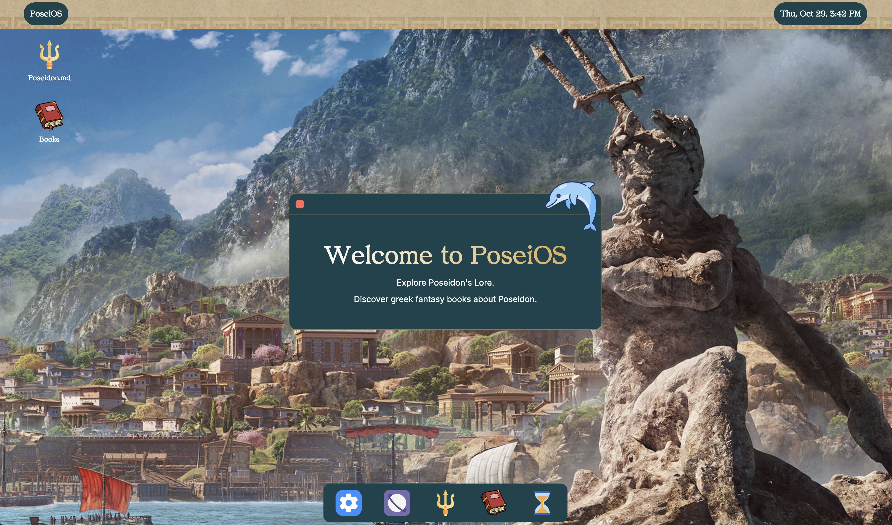

<div align="center" >

# PoseiOS



**A Poseidon-themed Operating System that runs directly in the browser.**


Made for Hack Club Stardance

</div>

## Features

- Poseidon.md - A notes app that uses localStorage to save notes
- Books - A compilation of greek fantasy books that includes stories about Poseidon
- A Glassmorphic Design and UI
- Select/Deselect features for app icons like a real operating system
- Real Time Clock at the top bar
- Custom Trident Cursor
- Timer App
- Simple Google Search Browser\*
- Dock

<sub>\*Note the browser feature only works for wikipedia for now (search `https://wikipedia.com` in the address bar).</sub>

## Tech Stack & Attributions

| Function          |        Framework         |
| :---------------- | :----------------------: |
| Framework         |           HTML           |
| Styling           |           CSS            |
| Scripts           |        Javascript        |
| App Icons         |         Magnific         |
| Background Images | Assassin's Creed Odyssey |
| More Wallpapers   |    Wallpapers Delight    |
| Sounds            |         Zapslat          |

## Getting Started

1. Clone the repo by running the command below in the terminal

```
git clone https://github.com/VITNT/PoseiOS.git
```

2. Open the repo folder in VSCode or another IDE that supports HTML/CSS/JS

3. Install the LiveServer extension and click "Go Live"

4. Open the local port and you should see PoseiOS in action!

## Deployment

PoseiOS is deployed using Vercel, but it could also be deployed through
similar services like Netlify and Github Pages.
